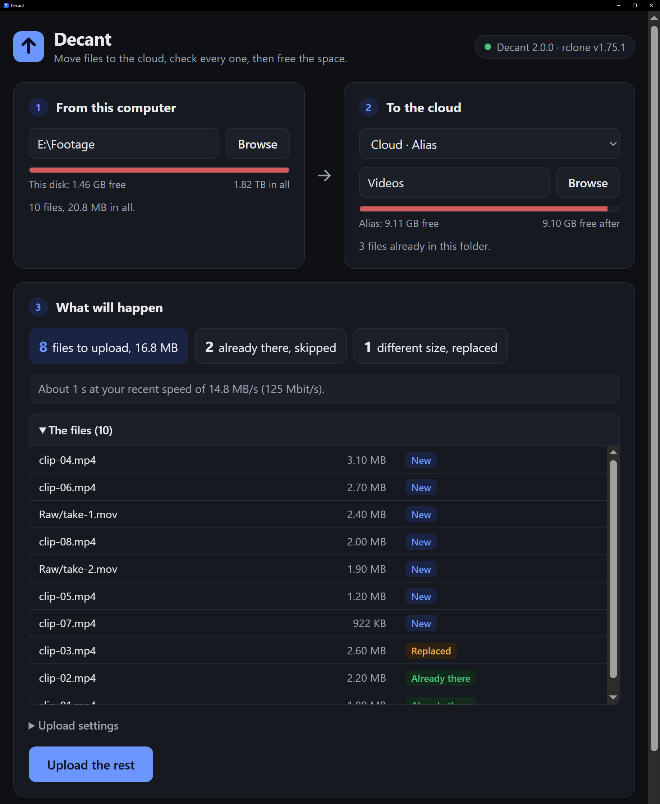
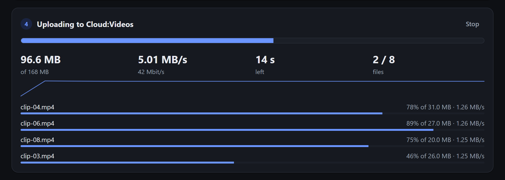
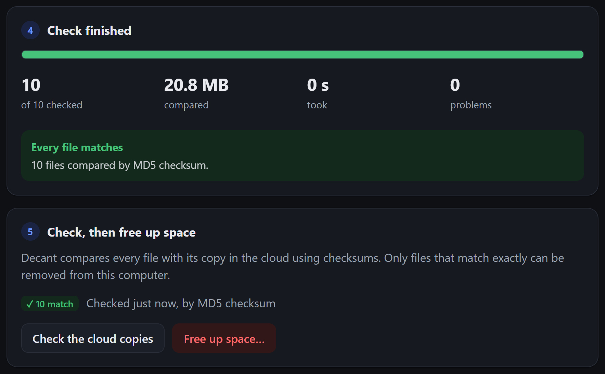

# Decant

[](https://github.com/dezdickey/Decant/actions/workflows/ci.yml)
[](https://github.com/dezdickey/Decant/actions/workflows/codeql.yml)
[](https://scorecard.dev/viewer/?uri=github.com/dezdickey/Decant)

**Move files to the cloud, prove every one arrived intact, then free the space on your disk.**

*To decant is to pour from one vessel into another without spilling a drop, leaving the first one empty. That is the whole job: every file moved intact, then the space given back. The checksum check is how Decant proves nothing spilled.*

Decant is a desktop app for Windows, macOS and Linux, built on [rclone](https://rclone.org). You pick a folder on your computer and a folder in the cloud. It shows what will happen, uploads with live progress, compares every file with its cloud copy by checksum, and only then offers to remove the local originals. It works with Google Drive, OneDrive, Dropbox, S3 and any of the 70-odd other backends rclone supports.

It is built security-first around one idea, **chain of custody**: data leaves the machine only with proof it arrived intact. A no-install browser version ships alongside the app.



*The screenshots use a demo folder, with a second disk standing in for the cloud.*

## Why I built it

I had about 200 GB of video to move to Google Drive, and it was painfully slow through the browser. The usual advice is to install Google's desktop app, but that copies every file into a cache on the system drive before uploading it, and my system drive had 2 GB free. rclone was the right tool: it uploads straight from where a file already is, in large pieces and several files at once. But it is a command line, and the step I actually cared about came after the upload. I wanted to delete the local copies to get the space back, and I only wanted to do that once I knew the cloud copies were complete.

So Decant is built around that last step.

## Security at a glance

- **The interface is the least trusted part.** It cannot reach rclone directly. Every call goes through a small Rust core, which holds rclone's password, allows a fixed list of 14 calls and strips sign-in tokens from replies. ([decision record](docs/decisions/0002-the-core-relays-every-rclone-call.md))
- **Nothing reaches rclone from a web page.** It listens only on 127.0.0.1 with a fresh 192-bit password and grants no cross-origin access.
- **Deleting is fenced in.** Only files that matched by checksum, unchanged since the check, inside the folder being offloaded, and whose copy is on a different disk. Removed files go to the Recycle Bin by default.
- **Tested by attacking it.** Live tests start the real rclone the way the app does and attack it, each also proving its setup is real, so a pass cannot come from a broken attack. Property-based tests throw thousands of generated paths at the deletion check.
- **Supply chain.** Every action pinned to a commit, `cargo audit`, CodeQL, OpenSSF Scorecard, and Dependabot. Releases carry checksums, an SBOM and GitHub build provenance.
- **No data leaves the device** except your files, to the cloud you chose. No accounts, telemetry or analytics.

Details: [THREAT_MODEL.md](THREAT_MODEL.md) · [SECURITY.md](SECURITY.md) · [decision records](docs/decisions/) · [roadmap](ROADMAP.md)

## What it does

1. **From:** a folder on this computer. Type or paste a path (Explorer's *Copy as path* quotes are fine), or browse your drives. It shows how much is in the folder and how full the disk is.
2. **To:** any remote you have set up in rclone, and a folder inside it. It shows the cloud's free space.
3. **What will happen:** the two sides are compared before anything moves: what is new, what is already there and will be skipped, what has a different size and will be replaced, whether it will fit, and how long it should take at your recent speed. On Google Drive it also warns about the 750 GB a day upload limit.
4. **Upload:** live progress with bytes, speed (in MB/s and in Mbit/s, the unit internet plans are sold in), time left, a speed graph and per-file bars. Errors are translated from rclone's wording into what happened and what to do. Close the window mid-upload and Decant keeps going from the tray.

   

5. **Check, then free up space:** every file is compared with its cloud copy by checksum. Only files that match exactly can be removed, to the Recycle Bin or permanently, and only after you confirm the list.

   

## Getting started

**Desktop app.** Download the installer for your system from [Releases](https://github.com/dezdickey/Decant/releases). rclone comes inside it. The installers are not code-signed yet (that is planned for 2.5), so the first time you run one, Windows shows *Windows protected your PC*: choose **More info**, then **Run anyway**. On macOS, allow it in System Settings under Privacy & Security. Each release lists how to check a download is genuine before you run it.

Until in-app sign-in arrives in 2.3, connect your cloud once with rclone itself:

```
rclone config
```

That is where you sign in to Google, Microsoft or another provider. Decant never sees your password.

**Browser version, no install.** Install rclone (`winget install Rclone.Rclone` on Windows, or see [rclone.org/install](https://rclone.org/install/)), run `rclone config` once, then double-click **`Decant.cmd`** on Windows or run **`./start.sh`** on macOS and Linux. Your browser opens on the app.

## How it works

```
Desktop app                                Browser version
┌──────────────────────────┐               Decant.cmd / start.sh
│ Interface (HTML/CSS/JS)  │                        │ starts
│   │ Tauri IPC            │                        ▼
│ Rust core: password,     │               rclone rcd ◀── HTTP + password ── page opened from disk
│ allowlist, path checks   │
│   │ HTTP, 127.0.0.1      │
│ rclone rcd (bundled)     │
└──────────────────────────┘
```

There is no back end of Decant's own. rclone ships a [remote-control API](https://rclone.org/rc/) that can do everything its command line can. These are the calls Decant uses, and in the desktop app the core allows no others:

| Step | rclone call |
|---|---|
| List folders and files on either side | `operations/list` |
| Disk and cloud space | `core/du`, `operations/about` |
| Upload in the background | `sync/copy` with `_async`, per-run settings in `_config`, backend options as a [connection string](https://rclone.org/docs/#connection-strings) |
| Live progress | `core/stats` for the job's group, `job/status` |
| Find an upload still running after the page reopens | `job/list`, matched on the server's `executeId` |
| Stop | `job/stop` |
| Compare by checksum | `operations/check` with `oneWay` and `match` |
| Free up space | `operations/stat`, then the core's own `free_file` (desktop) or `operations/deletefile` (browser) |

## Safety details

- **Only files that matched by checksum** can be selected for removal. If the cloud and the disk have no checksum in common, rclone can only compare sizes. Decant says so plainly and will not remove anything on that basis.
- **Each file is looked at again just before it is removed.** If its size or modification time has changed since the check, it is kept.
- **Decant refuses when the copy is not really somewhere else:** inside the same folder, on the same disk (nothing would be freed), or behind a remote such as an encrypted one where it cannot tell where the files really live.
- **Recycle Bin by default.** It can be restored, but the space only comes back when the bin is emptied, and the app says so. Permanent deletion is a separate, explicit choice.
- **The browser version** puts its per-launch password in `ui/session.js`, which the launcher rewrites each time and git ignores, and allows only the page opened from disk to make cross-origin requests. See the threat model for how it differs from the app.

## Google Drive notes

- **750 GB a day.** Google limits each account's uploads. Decant warns when a plan goes over, and by default sets rclone's `stop_on_upload_limit`, so the run stops cleanly instead of failing file after file. Run it again the next day: files already up are skipped.
- **Piece size.** Uploads go up in 256 MB pieces by default, rather than rclone's 8 MB. Each piece waits for a reply, so fewer pieces means fewer pauses. Memory use is the piece size times the number of files going up at once.
- **Your own client ID.** rclone's built-in Google sign-in is shared by every rclone user, is often rate-limited, and is [being retired during 2026](https://rclone.org/drive/#making-your-own-client-id). If uploads stall with "slow down" messages, create your own. It takes about 10 minutes in Google's developer console. Choose a *Desktop app*, then publish the app, or the sign-in expires every week.

## Limits

- rclone cannot pause an upload. **Stop** ends it, and starting again skips every finished file. A file that was halfway up starts again from the beginning.
- **A dropped connection ends the upload.** Files that had not started yet fail at once, and nothing retries them. Run the upload again once you are back online: everything that finished is skipped. A real overnight upload showed this when the Wi-Fi dropped.
- **Decant does not keep the computer awake.** For a long upload, keep the computer plugged in and set it not to sleep.
- Encrypted (`crypt`) remotes are compared by size only, so Decant will not free space for them. rclone's `cryptcheck` command can verify them properly from a terminal.
- The app is tested by hand on Windows. The release workflow also builds macOS and Linux installers, but nobody has run those by hand yet.

## Building from source

You need Rust (stable), plus Microsoft's C++ Build Tools on Windows, the [Tauri prerequisites](https://tauri.app/start/prerequisites/) on Linux, or Xcode's command-line tools on macOS.

```
scripts/fetch-rclone.sh              # the bundled rclone, checked against its published SHA-256
cargo install tauri-cli --version "^2" --locked
cargo tauri dev                      # run it
cargo tauri build                    # installers, in src-tauri/target/release/bundle
```

Run the tests from `src-tauri/` with `cargo test`. The live tests need the rclone fetched above.

## Project layout

```
src-tauri/                 the desktop app's Rust core
  src/rclone.rs            starting rclone, the allowlist and the relay, live tests
  src/paths.rs             the containment check before anything is removed, property tests
  src/lib.rs               the three commands the interface may call, the tray, the lifecycle
  capabilities/            which window may call which command
  tauri.conf.json          window, security policy, bundling
ui/                        the interface, shared by the app and the browser version
  index.html, style.css    the page; light and dark from the system setting
  app.js                   state, rendering, jobs, folder browser
  rc.js                    the API client, and the table that explains rclone's errors
  format.js                sizes, speeds and durations in words
tests/index.html           tests for format.js and rc.js, run in a browser
scripts/fetch-rclone.sh    fetches and verifies the bundled rclone
Decant.cmd, start.ps1      browser version launcher (Windows)
start.sh                   browser version launcher (macOS, Linux)
docs/decisions/            why things are the way they are
.github/                   CI, CodeQL, Scorecard, Dependabot, release pipeline
```

## How it was tested

- **The Rust core** (`cargo test`): unit tests; live tests that start the real rclone the way the app does and attack it (forbidden calls and planted tokens through the relay, wrong passwords and cross-origin preflights at rclone itself), each also proving its setup is real, for example that the same purge sent straight to rclone does delete; and property-based tests that send 4,000 generated paths at the deletion check. CI runs them on every pull request and every push to `main`, with Clippy, `cargo audit` and CodeQL. Without the bundled rclone the live tests skip themselves, so CI always fetches it first.
- **The interface** (`tests/index.html`): every number format at its edges, and every rule in the error table against a sample of the error it exists for. That found a real bug: an unknown remote was being explained as broken settings.
- **By hand, on Windows**, against an isolated rclone config whose "cloud" was a folder on a second disk:
  - the desktop app: an upload under a speed cap; closing the window mid-upload, so it continued from the tray; the checksum check; a removal confirmed in the Recycle Bin; and quitting, which stops rclone;
  - the browser version: reloading mid-upload, a file edited after the check (it was kept), a size-only comparison (removal stayed locked), the folder browser, phone width, and light and dark.

The bugs testing found are written up in [THREAT_MODEL.md](THREAT_MODEL.md#how-20-was-attacked).

To run the interface tests headless, pass Chrome the page's full path and a throwaway profile, then read the title:

```
# Windows (PowerShell)
& "$env:ProgramFiles\Google\Chrome\Application\chrome.exe" --headless=new --user-data-dir="$env:TEMP\decant-tests" --virtual-time-budget=3000 --dump-dom "$PWD\tests\index.html" | Select-String '<title>'

# macOS and Linux
google-chrome --headless=new --user-data-dir="$(mktemp -d)" --virtual-time-budget=3000 --dump-dom "$PWD/tests/index.html" | grep -o '<title>[^<]*'
```

## License

Decant is licensed under the [Apache License 2.0](LICENSE). It bundles rclone, which is MIT-licensed.

---

Decant is not affiliated with or endorsed by Google or the rclone project. Google Drive is a trademark of Google LLC.
