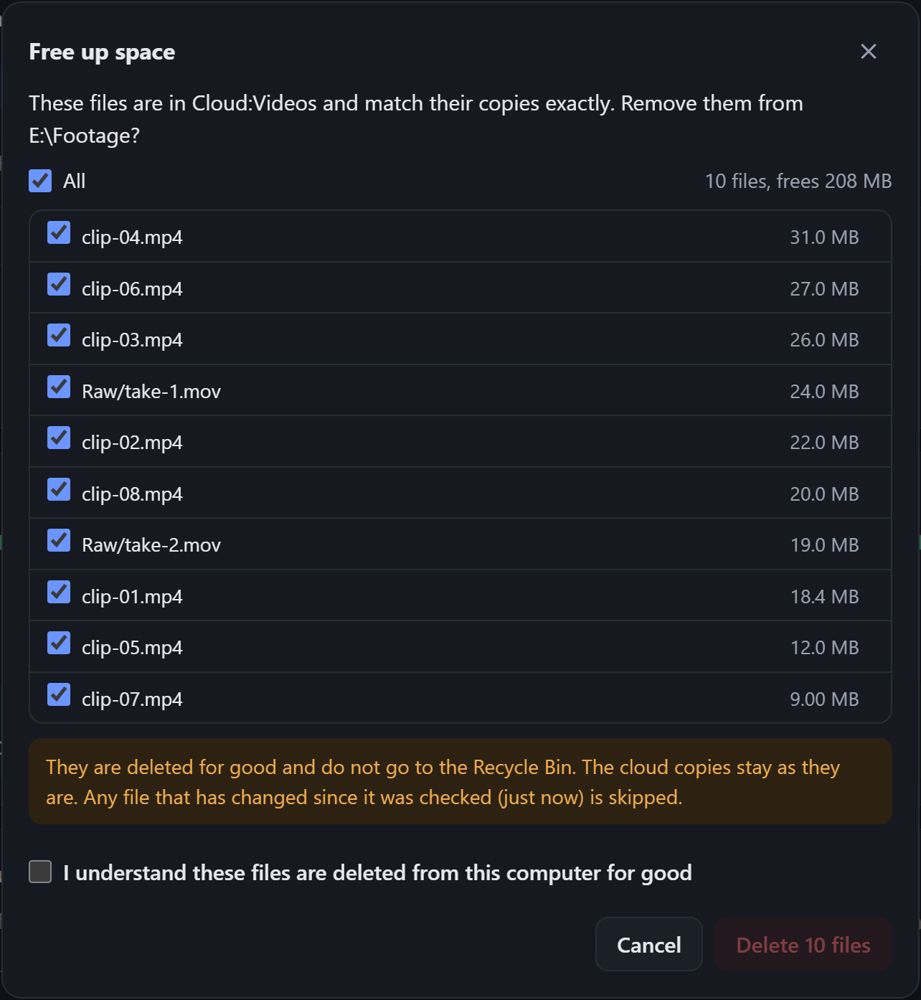

# Offload

**Move files to the cloud, prove every one arrived intact, then free the space on your disk.**

Offload is a small local web app on top of [rclone](https://rclone.org). You pick a folder on your computer and a folder in the cloud. It shows what will happen, uploads with live progress, compares every file with its cloud copy by checksum, and only then offers to delete the local originals. It works with Google Drive, OneDrive, Dropbox, S3 and any of the 70-odd other backends rclone supports.

No framework, no build step, no `package.json`. It is a launcher script and a page of plain HTML, CSS and JavaScript (about 1,800 lines in all), and the only dependency is rclone itself.


*The screenshots use a demo folder, with a second disk standing in for the cloud.*

## Why I built it

I had about 200 GB of video to move to Google Drive, and my system drive had only 2 GB free. rclone was the right tool for that: it uploads straight from where each file already is, several files at once and in large pieces. But it is a command line, and the step I actually cared about came after the upload. I wanted to delete the local copies to get the space back, and I only wanted to do that once I knew the cloud copies were complete.

So Offload is built around that last step.

## What it does

1. **From:** a folder on this computer. Type or paste a path (Explorer's *Copy as path* quotes are fine), or browse your drives. It shows how much is in the folder and how full the disk is.
2. **To:** any remote you have set up in rclone, and a folder inside it. It shows the cloud's free space.
3. **What will happen:** the two sides are compared before anything moves: what is new, what is already there and will be skipped, what has a different size and will be replaced, whether it will fit, and how long it should take at your recent speed. On Google Drive it also checks the plan against the day's upload allowance.
4. **Upload:** live progress with bytes, speed (in MB/s and in Mbit/s, the unit internet plans are sold in), time left, a speed graph and per-file bars. Errors are translated from rclone's wording into what happened and what to do. Close the tab and the upload carries on; open Offload again and it picks the running upload back up.

   

5. **Check, then free up space:** every file is compared with its cloud copy by checksum. Only files that match exactly can be removed from the computer, and only after you confirm the list.

   

   

## Getting started

1. Install rclone: `winget install Rclone.Rclone` on Windows, or see [rclone.org/install](https://rclone.org/install/).
2. Connect your cloud once: `rclone config`. This is where you sign in to Google, Microsoft or another provider. Offload never sees your password.
3. Start Offload: double-click **`Offload.cmd`** on Windows, or run **`./start.sh`** on macOS and Linux. Your browser opens on the app.

To stop it, use **Stop server** in the top corner.

## How it works

```
Offload.cmd / start.sh ──starts──▶ rclone rcd  (127.0.0.1 only, random password)
                                        ▲
ui/index.html (opened from disk) ───────┘  JSON over HTTP: rclone's remote-control API
```

There is no back end of Offload's own. rclone ships a [remote-control API](https://rclone.org/rc/) that can do everything its command line can, and the page calls it directly:

| Step | rclone call |
|---|---|
| List folders and files on either side | `operations/list` |
| Disk and cloud space | `core/du`, `operations/about` |
| Upload in the background | `sync/copy` with `_async`, per-run settings in `_config`, backend options as a [connection string](https://rclone.org/docs/#connection-strings) |
| Live progress | `core/stats` for the job's group, `job/status` |
| Find an upload still running after the page reopens | `job/list`, matched on the server's `executeId` |
| Stop | `job/stop` |
| Compare by checksum | `operations/check` with `oneWay` and `match` |
| Free up space | `operations/stat` then `operations/deletefile`, one file at a time |

## Security and safety

A local server that can delete files deserves some care. This is what is in place and why.

- **Only this computer can reach it.** rclone listens on 127.0.0.1, never on the network.
- **A fresh password every launch.** The launcher generates 24 random bytes and hands them to rclone through environment variables rather than on the command line, where other programs could read them from the process list. The page reads them from `ui/session.js`, which the launcher rewrites each time and git ignores.
- **Other websites cannot drive it.** Offload never lets the browser remember the password, so no other page you visit can send commands with it. The page attaches the password to each request itself, and a browser will not let another site add that header without the server's permission, which is only given to the page opened from disk.
- **Locked-down page.** A Content Security Policy allows scripts and styles only from the app's own files and connections only to 127.0.0.1. There are no CDNs, web fonts, analytics or any other outside requests.
- **Deleting is fenced in:**
  - Only files that matched by **checksum** can be selected. If the cloud and the disk have no checksum in common, rclone can only compare sizes. Offload says so plainly and will not delete anything on that basis.
  - Each file is **looked at again just before it is deleted**. If its size or modification time has changed since the check, it is kept.
  - Offload **refuses when the copy is not really somewhere else**: inside the same folder, on the same disk (nothing would be freed), or behind a remote such as an encrypted one where it cannot tell where the files really live.
  - Deleting needs a ticked confirmation over the exact list of files. The page also says plainly that the files skip the Recycle Bin.

## Google Drive notes

- **The daily upload allowance.** Offload checks each plan against the day's upload allowance, and by default sets rclone's `stop_on_upload_limit`, so a big run stops cleanly. Run it again the next day: files already up are skipped.
- **Piece size.** Uploads go up in 256 MB pieces by default. Each piece waits for a reply, so bigger pieces mean fewer pauses. Memory use is the piece size times the number of files going up at once.
- **Your own client ID.** For the smoothest uploads, give your Drive remote its own Google client ID, as [rclone's guide](https://rclone.org/drive/#making-your-own-client-id) explains. It takes about 10 minutes in Google's developer console: choose a *Desktop app*, then publish it.

## Limits

- Offload can't pause an upload yet. **Stop** ends it, and starting again skips every finished file. A file that was halfway up starts again from the beginning.
- Encrypted (`crypt`) remotes are compared by size only, so Offload will not free space for them. rclone's `cryptcheck` command can verify them properly from a terminal.
- Opened from disk, the page shares the browser's storage with other local pages. It keeps only small conveniences there, namely the last folders, the settings and the recent runs, all under an `offload.` prefix.

## Project layout

```
Offload.cmd      Windows launcher: double-click to start
start.ps1        what Offload.cmd runs: finds rclone, starts it, opens the page
start.sh         the same for macOS and Linux
ui/index.html    the page
ui/style.css     all styling; light and dark from the system setting
ui/app.js        the app: state, rendering, jobs, folder browser
ui/rc.js         the API client, and the table that explains rclone's errors
ui/format.js     sizes, speeds and durations in words
tests/index.html tests for format.js and rc.js: open it in a browser
docs/            the screenshots in this README
```

## How it was tested

Every step was driven in a real browser against an isolated rclone config, never a real cloud account. The "cloud" was a folder on a second disk, reached three ways: a plain local remote, an alias, and an encrypted remote. The tests covered: uploading new, existing and changed files under a speed cap so progress could be watched; reloading the page mid-upload; the checksum check; freeing space with one file edited after the check (it was kept); a size-only comparison (deleting stayed locked); a mistyped folder; the folder browser; phone width; light and dark; and stopping the server. Separately, the page was loaded straight from disk in headless Chrome, to confirm that the security policy and the cross-origin requests behave as intended there.

`format.js` and `rc.js` have no DOM in them on purpose, so they are tested on their own by **`tests/index.html`**, a page with no dependencies and no server. It checks every number format at its edges (zero, missing, negative, unit boundaries, the rates rclone accepts) and sends each rule in the error table a sample of the error it is there for: captured from rclone wherever the error can be caused locally, and written in Google's error format for the ones that need a real account. Some samples also check the order of the rules, since the first match wins. That found a real bug: rclone reports an unknown remote as `didn't find section in config file`, which the page used to explain as broken settings.

Open it in any browser to see each result. To run it headless, pass Chrome the page's full path and a throwaway profile folder, then read the title, which says `Offload tests: N passed, 0 failed`:

```
# Windows (PowerShell)
& "$env:ProgramFiles\Google\Chrome\Application\chrome.exe" --headless=new --user-data-dir="$env:TEMP\offload-tests" --virtual-time-budget=3000 --dump-dom "$PWD\tests\index.html" | Select-String '<title>'

# macOS and Linux (use google-chrome, chromium, or the full path to Chrome)
google-chrome --headless=new --user-data-dir="$(mktemp -d)" --virtual-time-budget=3000 --dump-dom "$PWD/tests/index.html" | grep -o '<title>[^<]*'
```

## Licence

Offload is licensed under the [Apache License 2.0](LICENSE). rclone, which Offload runs but does not include, is MIT-licensed.

---

Offload is not affiliated with or endorsed by Google or the rclone project. Google Drive is a trademark of Google LLC.
